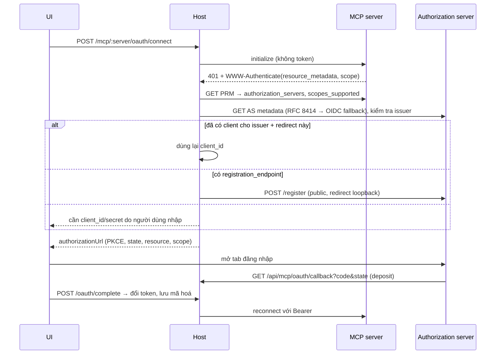

# Phân tích: OAuth cho remote MCP server (discovery + dynamic client registration)

- **Thời điểm:** 2026-10-12 17:16 (+07:00)
- **Mục đích:** chuẩn bị cho việc bổ sung OAuth, để MCP catalog sau này có thể thêm Notion, Linear, Atlassian, Sentry, GitLab và các server hosted khác.
- **Bằng chứng:** đọc code `src/harness/mcp/{oauth,oauth-store,client,config,outbound-policy}.ts`, `src/web/server.ts`, `web/`; gọi thử metadata OAuth thật của 8 server; đọc MCP authorization spec bản 2025-11-25.

## Kết luận

Phần backend OAuth hiện có khá chắc ở nửa sau của flow: PKCE S256, `resource` (RFC 8707), callback chỉ nhận code, token mã hoá AES-256-GCM, refresh có fencing, và revoke. Nửa đầu thì gần như chưa có gì. Host chưa tự **discover** authorization server, chưa **đăng ký client**, chưa **lưu cấu hình OAuth** của từng server, và **web UI không có một dòng OAuth nào**. Hiện tại `/oauth/begin` bắt người gọi tự đưa endpoint, `clientId` và `redirectUri`, nên chỉ test fixture mới dùng được.

Để kết nối được với server thật, cần làm 4 việc: discovery theo RFC 9728/8414, dynamic client registration (RFC 7591), một flow "Connect" trên UI, và xử lý `auth_required` cho người dùng. Hướng em khuyên làm là **DCR với public client (`token_endpoint_auth_method: none`) và redirect về loopback**. Em đã thử đăng ký thật với Linear và Atlassian, cả hai đều trả `client_id` ngay.

## Hiện trạng trong code

| Phần | Trạng thái | Vị trí |
|---|---|---|
| Authorization code + PKCE S256 | Có | `ManagedOAuth.begin` |
| `resource` trong authorize, token và refresh | Có | `oauth.ts` |
| Callback công khai, chỉ nhận code, không tạo session | Có | `/api/mcp/oauth/callback` → `handleOAuthDeposit` |
| Transaction dùng một lần, hết hạn sau 5 phút | Có | `OAuthStore.takeTransaction` |
| Lưu token mã hoá, refresh có lock và fence, revoke | Có, có test | `oauth-store.ts`, `tests/harness/mcp-oauth.spec.ts` |
| Gắn token vào request, tự refresh khi gặp 401/403 | Có | `resolveMcpAuth` → `tokenSource` trong `client.ts` |
| Discovery: đọc `WWW-Authenticate`, PRM, AS metadata | **Chưa có** | |
| Dynamic client registration | **Chưa có** (header `oauth.ts` ghi rõ) | |
| `client_secret` (confidential client) | **Chưa có**. Chỉ gửi `client_id` | `exchange`, `refresh` |
| Lưu endpoint/issuer/scopes theo từng server | **Chưa có**. `managed_oauth` chỉ có `provider`, `resource`, `clientId`, `scopes`, còn endpoint thì người gọi phải tự truyền vào | `config.ts:33` |
| `redirectUri` do host quyết định | **Chưa có**. Lấy từ body request | `server.ts:5149` |
| Web UI: Connect, trạng thái, Disconnect | **Chưa có** (grep `oauth` trong `web/` không ra kết quả nào) | |
| `revocationEndpoint` | Người gọi tự truyền vào | `server.ts:5166` |

Hai lỗi bảo mật cần sửa trong cùng đợt này:

1. **`redirectUri` lấy từ body request.** Người gọi có thể truyền bất kỳ URI nào. Host phải tự dựng URI từ origin mà nó đang lắng nghe, rồi so khớp với URI đã đăng ký.
2. **Endpoint cũng lấy từ body.** Dù đã qua `assertOutboundUrl`, nguồn tin cậy của endpoint vẫn phải là metadata discovery (đã kiểm tra `issuer`) và được lưu lại phía host, không được lấy từ client.

## Server thật trả lời ra sao (probe ngày 2026-10-12)

| Server | PRM | Authorization server | DCR | CIMD | Đánh giá |
|---|---|---|---|---|---|
| Notion `mcp.notion.com/mcp` | có | chính nó | có, `none` | có | DCR chạy được |
| Linear `mcp.linear.app/mcp` | có | chính nó | **đăng ký thử thành công** | có | DCR chạy được |
| Atlassian `mcp.atlassian.com/v1/mcp` | không có ở đường dẫn chuẩn | chính nó | **đăng ký thử thành công** | không | DCR chạy được, cần fallback discovery |
| Sentry `mcp.sentry.dev/mcp` | có | chính nó | có, `none` | có | DCR chạy được |
| GitLab `gitlab.com/api/v4/mcp` | có | gitlab.com | có, nhưng chỉ `client_secret_*` | không | cần hỗ trợ confidential client |
| Supabase `mcp.supabase.com/mcp` | có | api.supabase.com | endpoint riêng của nền tảng, chỉ `client_secret_*` | không | cần confidential client, rủi ro cao |
| Slack `mcp.slack.com` | có | AS là slack.com | **không** | không | cần Slack app đăng ký trước (client_id/secret) |
| GitHub `api.githubcopilot.com/mcp/` | có | github.com/login/oauth | **không** | không | cần OAuth app đăng ký trước, hoặc dùng PAT như catalog spec |

Ghi chú: Linear và Atlassian có thêm 2 client tên `dnt-harness-probe` do em đăng ký thử. Client chưa được cấp quyền gì và không có token.

## MCP spec yêu cầu gì (bản 2025-11-25)

- Client **MUST** dùng Protected Resource Metadata (RFC 9728) để tìm authorization server. Ưu tiên URL `resource_metadata` trong header `WWW-Authenticate` của response 401, nếu không có thì thử các đường dẫn well-known theo thứ tự. Với AS metadata cũng phải thử cả RFC 8414 lẫn OpenID theo thứ tự quy định.
- Thứ tự ưu tiên khi đăng ký client: (1) client đã đăng ký trước, (2) Client ID Metadata Document (CIMD) nếu AS có `client_id_metadata_document_supported`, (3) DCR nếu có `registration_endpoint`, (4) cuối cùng là cho người dùng tự nhập client info.
- Client **MUST** gửi `resource` (RFC 8707). Phần này đã có.
- Chọn scope: lấy `scope` trong `WWW-Authenticate` trước, nếu không có thì dùng `scopes_supported` của PRM. Gặp `insufficient_scope` thì **SHOULD** làm step-up.
- Host đang pin protocol `2025-06-18`. Bản đó đã bắt buộc PRM + RFC 8414 + `resource`, còn DCR là SHOULD. Vì vậy làm DCR ngay bây giờ vẫn đúng spec mà không phải nâng protocol.

**CIMD chưa nên làm đợt này.** CIMD đòi `client_id` là một URL HTTPS công khai trỏ tới file metadata do mình host. Host là app local, không tự phục vụ được URL đó. Có thể đặt một file tĩnh, ví dụ trên GitHub Pages, nhưng `redirect_uris` trong file phải khớp với port loopback. Spec cũng cảnh báo CIMD không ngăn được việc giả mạo `localhost`. Mọi server có CIMD trong danh sách trên (Notion, Linear, Sentry) đều cũng có DCR, nên DCR đã đủ để phủ chúng.

## Phương án

### A. DCR public client + loopback redirect + nhập tay client đã đăng ký (khuyên dùng)

Flow khi người dùng bấm **Connect** trên một server `http`:

Các thành phần cần thêm:

1. **`src/harness/mcp/oauth-discovery.ts`**: parse `WWW-Authenticate`, lấy PRM (header trước, sau đó các đường dẫn well-known), lấy AS metadata theo thứ tự spec, kiểm tra `issuer` khớp, bắt buộc có S256, mọi URL đều qua `assertOutboundUrl` và `redirect: 'manual'`, giới hạn kích thước response.
2. **`src/harness/mcp/oauth-registration.ts`**: DCR theo RFC 7591. Gửi lên `client_name`, `redirect_uris` (chính xác là loopback callback), `grant_types: [authorization_code, refresh_token]`, `token_endpoint_auth_method: none`. Kết quả lưu vào `OAuthStore` (đã mã hoá), key theo `issuer + redirectUri`, để dùng lại thay vì mỗi lần Connect lại đăng ký client mới.
3. **Mở rộng config `managed_oauth`**: ghi `issuer` đã discover cùng `resource`. Endpoint và client lấy từ store khi cần, không do request truyền vào. `clientId` thành tuỳ chọn (có thể lấy từ đăng ký).
4. **Hỗ trợ `client_secret`** (post/basic) cho client người dùng nhập tay. Secret lưu trong `OAuthStore`, không ghi vào `mcp.json`. Phần này giúp GitHub, Slack, GitLab và Supabase kết nối được nếu người dùng tự tạo OAuth app.
5. **Route**: thêm `POST /api/workspaces/:id/mcp/:server/oauth/connect`, làm discovery và đăng ký rồi trả `authorizationUrl`. Bỏ việc nhận endpoint, `clientId` và `redirectUri` từ body ở `begin`. `redirectUri` do host dựng từ origin đang lắng nghe. `revoke` dùng `revocation_endpoint` đã discover. Cập nhật `ROUTE_INVENTORY`.
6. **Web UI trong McpPanel**: server `http` có badge `Needs sign-in` hoặc `Connected`, cùng các nút **Connect / Reconnect / Disconnect**. Bấm Connect thì mở tab đăng nhập; tab hiện tại poll trạng thái hoặc có nút "Tôi đã đăng nhập xong" để gọi `complete`. Form Add server có thêm lựa chọn auth "OAuth (tự động)", kèm phần mở rộng để nhập tay client_id/secret.
7. **Trạng thái `auth_required`** hiện rõ ở list server, thay vì chỉ là `failed` cùng một `lastError` chung chung.

Ưu điểm: phủ ngay Notion, Linear, Atlassian, Sentry. Đường nhập tay phủ thêm GitHub, Slack, GitLab, Supabase. Đúng thứ tự ưu tiên của spec (pre-registered, rồi DCR, rồi nhập tay). Tái dùng được gần hết `ManagedOAuth`.
Nhược điểm: phần lớn công việc nằm ở discovery (nhiều nhánh fallback, như Atlassian không có PRM ở đường dẫn chuẩn) và ở UI.

### B. Chỉ DCR, không có nhập tay

Nhỏ hơn A khoảng một phần năm khối lượng, nhưng GitHub, Slack, GitLab và Supabase sẽ hoàn toàn không dùng được qua OAuth. Thực tế GitHub và Slack lại là hai cái được hỏi tới nhiều nhất.

### C. Làm đầy đủ A + CIMD

Thêm CIMD theo đúng thứ tự ưu tiên của spec. Cần một URL HTTPS công khai để host file metadata, và phải giải quyết chuyện port loopback thay đổi. Hiện không có server nào trong danh sách cần CIMD mà lại thiếu DCR, nên em chưa thấy lợi ích tương xứng.

## Những rủi ro cần quyết trong thiết kế

1. **Redirect URI và port.** Nếu đổi port, client đã đăng ký sẽ không còn khớp. Đề xuất: key client theo `issuer + redirectUri`, gặp port mới thì đăng ký lại. Khi host chạy sau `allowedHosts` hoặc truy cập từ máy khác (không phải loopback), redirect phải đi qua origin công khai; HTTP không phải loopback thì nhiều AS sẽ từ chối. Đây là một quyết định cần anh chốt.
2. **Ai được bấm Connect.** `begin` và `complete` đã gắn với `principalId`, có CSRF qua cookie. Giữ nguyên, và yêu cầu `complete` phải do cùng browser session gọi.
3. **SSRF khi discovery.** URL lấy từ header 401 của server do người dùng nhập. Mọi hop đều phải qua `assertOutboundUrl` (đã chặn dải private), không follow redirect, đặt timeout và giới hạn kích thước.
4. **Mix-up attack.** Phải kiểm tra `issuer` trong AS metadata khớp đúng với authorization server được PRM chỉ định, và nếu callback có `iss` thì so khớp luôn (RFC 9207).
5. **Kế thừa test.** `tests/harness/mcp-oauth.spec.ts` và `tests/web/mcp-integration-review.spec.ts` đang gọi `begin` với endpoint trong body. Cần sửa các test này khi bỏ đường đó, hoặc giữ đường cũ trong chế độ test fixture.

## Bước tiếp theo

Anh chốt các câu hỏi bên dưới, em sẽ viết spec cho phương án được chọn vào `docs/superpowers/specs/`, sau đó lập kế hoạch implement. MCP catalog (spec `28bb345`) sẽ được cập nhật sau đợt này để đưa các server OAuth vào.

## Câu hỏi chưa giải quyết

1. Chọn phương án A (DCR + nhập tay client), B (chỉ DCR) hay C (thêm cả CIMD)?
2. Host chỉ cần chạy ở loopback (`127.0.0.1`/`localhost`), hay phải hỗ trợ OAuth cả khi truy cập qua `allowedHosts` từ máy khác?
3. Sau khi đăng nhập, UI tự hoàn tất bằng cách poll trạng thái, hay để người dùng bấm "Tôi đã đăng nhập xong"?
4. Có cần step-up khi gặp `insufficient_scope` trong đợt này không, hay chỉ báo lỗi và cho bấm Reconnect?
